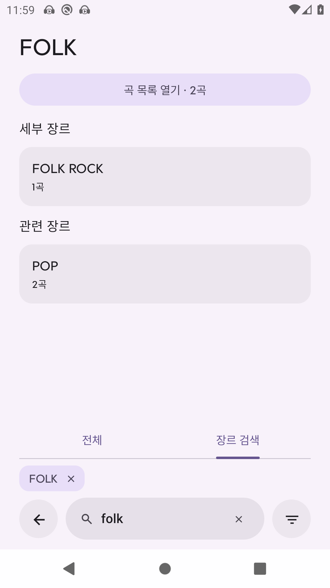

# 장르 탐색

검색 화면의 **전체** 탭은 기존 곡·앨범·아티스트·플레이리스트 검색을 유지합니다. **장르 검색** 탭은 곡 제목 대신 보관함에 있는 장르와 곡 수를 보여줍니다. 두 탭의 검색어는 따로 유지합니다.

장르를 입력하면 일치하는 장르 목록이 나옵니다. 예를 들어 `록`이나 `rock`으로 `ROCK`, `HARD ROCK`, `인디 록`을 찾을 수 있습니다. 실제 보관함에 있는 태그만 표시하며 없는 장르나 곡을 만들어 넣지 않습니다. 한국어 초성 검색과 일반적인 한국어·영어 장르 별칭을 지원합니다.

장르를 선택하면 다음을 모두 사용할 수 있습니다.

- **세부 장르**: 선택한 장르 이름을 포함하는 더 구체적인 장르입니다. `ROCK`에서 `HARD ROCK`이나 `인디 록`을 선택할 수 있습니다.
- **관련 장르**: 같은 장르 계열의 이름이나 같은 곡에 함께 붙은 태그를 기준으로 연결합니다. 외부 서비스의 공식 장르 계층이나 오디오 분석 결과로 간주하지 않습니다.
- **곡 목록 열기**: 선택한 장르 태그가 붙은 곡을 기존 곡 목록 화면에서 엽니다. `ROCK` 목록이 `HARD ROCK`의 곡까지 자동으로 포함하지는 않습니다. 곡의 재생·메뉴·큐·플레이리스트 작업은 기존 화면을 사용합니다.

다른 장르를 누르면 탐색을 이어갈 수 있고, 뒤로 가기로 이전 장르와 검색 결과로 돌아갑니다. 검색어를 바꾸면 장르 목록에서 다시 찾습니다. 장르 태그·파일 메타데이터는 이 탐색으로 바뀌지 않습니다.

검증용 보관함에서 실행한 실제 Android 화면입니다.

