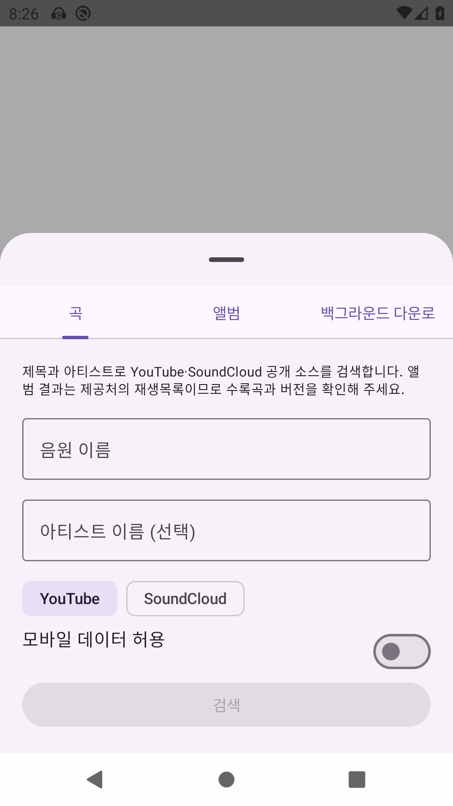
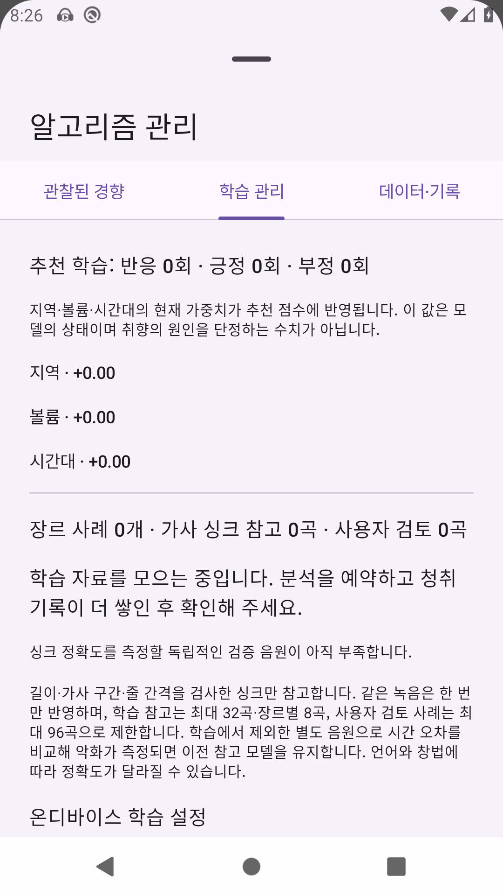
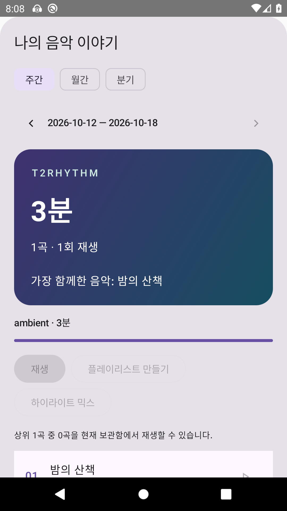

# 이미지·영상 보존과 개인 음악 경험 검증

## 확인된 결과

- 앱 단위 테스트 **278개**, 크롤러 단위 테스트 **52개**: 총 **330개 통과**, 실패·오류·건너뜀 0개. 로컬 XML 집계와 GitHub CI 성공을 확인했습니다.
- [Android CI](https://github.com/tak2-08/T2Rhythm/actions/runs/39110819182): 전체 Lint, GitHub 릴리스·디버그 APK 빌드, 단위 테스트 통과.
- [Android 회귀 검증](https://github.com/tak2-08/T2Rhythm/actions/runs/39110819184): API 29 x86_64 기기에서 **11개 통과**, 실패·오류·건너뜀 0개. 다섯 묶음의 XML을 각각 내려받아 실제 개수도 확인했습니다.

검증한 기능 코드는 `15536a8`입니다. 아래 화면과 데이터는 자동 테스트에서 만든 재현 가능한 자료이며 실제 사용자 청취 기록이 아닙니다.

## Android 검증 범위

| 테스트 묶음 | 개수 | 확인하는 동작 |
| --- | ---: | --- |
| AssetIntegrityRegressionTest | 4 | 수동 커버·영상 연결 보존, 고립 영상 복구/삭제, 가사 시간 조정, 실제 SQL 청취량 집계 |
| DownloadPlaybackRegressionTest | 1 | 라이브러리 스캔 전 완료 파일 재생, 미완성·누락 파일 거절 |
| PersonalInsightsScreensTest | 4 | 음원/앨범 검색, 알고리즘 탭, 청취 보고서, 로컬 AAC 구간 믹스 종료 |
| ArtworkRefreshTest | 1 | 기존 이미지 재로딩 회귀 |
| MetadataEditRaceTest | 1 | 비동기 정보 병합 중 사용자 수정 보존 |

화면 테스트에서 종료 시 `ensurePlaylistsSaved()`의 `runBlocking`이 UI를 기다리는 로더와 서로 대기하는 문제도 재현했습니다. 종료 저장은 ViewModel보다 오래 살아 있는 비동기 작업으로 처리하고, 교체된 ViewModel과 같은 잠금을 쓰며, 백업만 저장 완료를 기다리도록 수정했습니다.

각 묶음을 별도로 실행하고 XML의 실제 실행 개수·실패·오류·건너뜀을 검사합니다. AGP 9에서 쉼표로 구분한 테스트 클래스 목록의 첫 묶음만 실행되는 경우를 발견해, 일부 실행을 전체 통과로 계산하지 않도록 했습니다.

수동 커버 검증에는 실제 Room 테이블 비우기와 MediaStore ID 변경/재사용 입력, 내장 커버 재추출, 명시적 이미지 삭제가 포함됩니다. 영상 검증은 연결 없는 파일을 발견해 두 곡에 연결하고 실제 파일 삭제 시 모든 공유 연결과 뒤늦은 다운로드 복구를 차단하는지 확인합니다.

단위 테스트에는 파형 초안·무음 거절, 중복 PCM/장르별 학습 제한, 가사 원본 변경 시 새 제안 허용, 주·월·분기의 윤년·연도 경계와 DST 검증이 포함됩니다. Android 테스트는 실제 기간 경계의 SQL 청취량을 별도로 확인합니다.

## 화면

다운로드·알고리즘 화면은 `15536a8` 실행에서, 청취 보고서 화면은 [6f38d26 실행](https://github.com/tak2-08/T2Rhythm/actions/runs/39109623131)의 통과한 보고서 테스트에서 수집했습니다. 청취 보고서 구성 요소의 코드는 두 버전에서 동일합니다.

### 음원·앨범 검색



### 알고리즘 학습 관리



### 주간 청취 보고서



## 재현

```sh
./gradlew :crawler:test :app:testGithubDebugUnitTest
./gradlew :app:lintGithubDebug :app:assembleGithubDebug :app:assembleGithubDebugAndroidTest
bash scripts/run_personal_experience_regression.sh
```

마지막 명령은 시작된 Android 기기와 `adb`가 필요합니다. GitHub의 **Personal experience regression** 작업은 KVM을 사용하는 API 29 x86_64 기기를 시작해 같은 명령을 실행합니다. 묶음별 XML·HTML, 기기 로그, 화면 PNG를 `personal-experience-regression` 아티팩트에 보관합니다. APK를 설치 상태로 유지해 화면을 수집합니다.

실기기의 장시간 배터리 소모, 외부 제공처의 모든 검색 결과와 지역별 이용 가능성은 이 회귀 묶음의 검증 범위 밖입니다. 선택 설치 음성 모델은 현재 한국어이며, 파형만 쓰는 제안은 낮은 신뢰도의 초안입니다. 검증 오차는 참고 LRC와의 일치도이며 보컬의 정답률을 뜻하지 않습니다.
